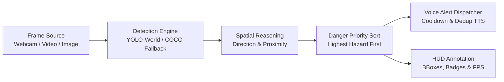
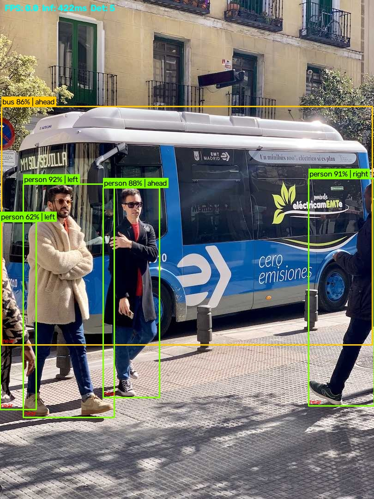
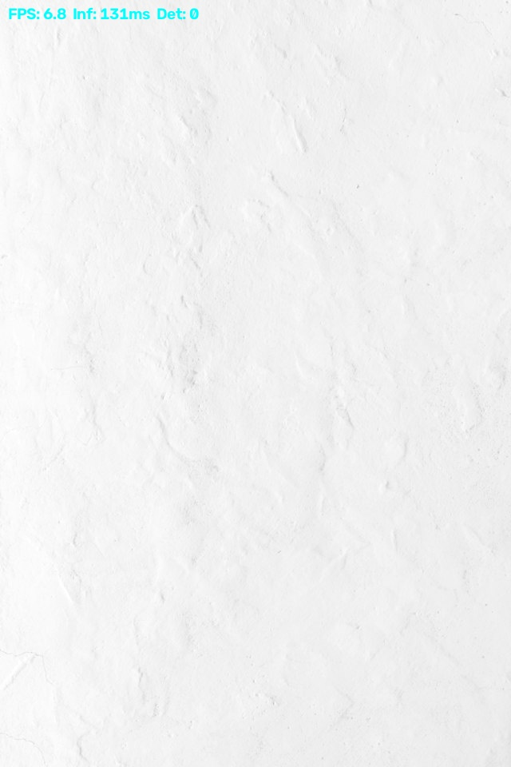
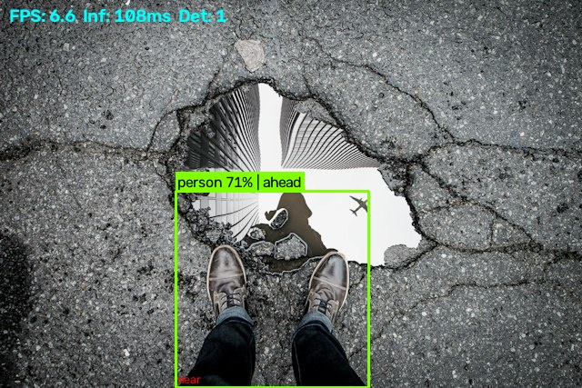

# RODD-Vision 🚦

[](https://www.python.org/downloads/)
[](https://opensource.org/licenses/MIT)
[](tests/)

**RODD-Vision** is an open-source, software-only computer vision assistive pipeline that detects road obstacles, estimates their lateral direction and proximity, orders them by collision hazard priority, and generates offline, non-blocking spoken voice alerts for visually impaired individuals.

---

## About

This project is an independent **software-only replication** of the vision and alert pipeline described in:

> **I. Nedjar, M. Bekkaoui, L. F. Boukli Hacene, and M. A. Benzineb**, *"Assistive Device for Visually Impaired Individuals Featuring Road Object Detection,"* **Arabian Journal for Science and Engineering**, vol. 51, pp. 12321–12340, January 2026.  
> DOI: [10.1007/s13369-025-11044-6](https://doi.org/10.1007/s13369-025-11044-6)

### What This Project Is NOT
* **Not hardware code**: This repository does not contain Raspberry Pi GPIO, physical ultrasonic sensor wiring, or microcontroller firmware.
* **Not sensor fusion**: Obstacle distance is estimated monocularly from camera bounding box geometry, not physical ultrasonic echo pulses.
* **Not trained model weights**: This implementation does not train or fine-tune models; it operates using pre-trained open-vocabulary weights (`YOLO-World`) with an automatic fallback to standard COCO-80 (`YOLOv8n`).
* **Not the original authors' codebase**: This is an independent, clean-room implementation of the published paper's architecture.

---

## Features

* **14 Target Road Obstacle Classes**: `building`, `bus`, `car`, `door`, `dustbin`, `electric pole`, `person`, `pillar`, `pit`, `road sign`, `stair`, `street chair`, `tram`, and `tree`.
* **Zero-Shot Object Detection**: Leverages Ultralytics `YOLO-World` (`yolov8s-worldv2.pt`) with open-vocabulary `set_classes()` prompting.
* **Graceful Fallback**: Automatically cascades to `CocoFallbackDetector` (YOLOv8n trained on COCO-80) if open-vocabulary weights fail to load.
* **Custom Weights Support**: Drop in your own trained `best.pt` checkpoint via `config.yaml` to detect all 14 classes with custom supervision.
* **Spatial Reasoning**:
  * **Direction**: Classifies objects into `left`, `ahead`, or `right` based on bounding box centroid relative to frame width.
  * **Proximity**: Estimates `near`, `medium`, or `far` using bounding box area ratio and ground-plane bottom-edge coordinates.
* **Danger-Based Priority Queue**: Sorts simultaneous detections by severity (e.g. `pit` > `stair` > `car` > `bus` > `person`), ensuring the most dangerous obstacle is announced first.
* **Non-Blocking Offline Voice Alerts**: Dedicated background TTS worker using `pyttsx3` with configurable announcement cooldown and message deduplication.
* **Dual User Interfaces**:
  * **OpenCV CLI**: Low-overhead terminal and live video window.
  * **Streamlit Web UI**: Interactive web interface with file upload, webcam mode, live detection table, and announcement history.
* **Batch Evaluation Tool**: [evaluate.py](file:///c:/S5/Open_Lab/RODD/rodd_vision/evaluate.py) profiles detection counts and latency across entire image directories.

---

## Architecture

### Pipeline Flow



### Module Mapping to Paper Sections

| Module | Paper Section (Nedjar et al., 2026) | Role in System |
|---|---|---|
| `rodd/sources.py` | **§III-A: Input Capture Module** | Multi-source ingestion (`webcam`, `video`, `image`, `folder`) |
| `rodd/detectors.py` | **§III-B: Object Detection** | Zero-shot YOLOWorld, COCO fallback, and custom weight loaders |
| `rodd/spatial.py` | **§III-C: Spatial Localisation & Proximity** | Direction (`left`/`ahead`/`right`), distance (`near`/`far`), danger sorting |
| `rodd/speech.py` | **§III-D: Voice Alert System** | Non-blocking thread-safe pyttsx3 engine with cooldown & deduplication |
| `rodd/pipeline.py` | **§III: System Architecture** | Integration pipeline connecting vision, spatial analysis, and audio |
| `rodd/config.py` | **§IV: Experimental Setup** | YAML configuration parsing into dataclasses |
| `evaluate.py` | **§V: Evaluation & Results** | Batch folder evaluation and latency profiling |
| `app.py` | **§III-E: User Interface** | Interactive Streamlit demo interface |

### Repository Structure

```
rodd_vision/
├── config.yaml          # System configuration and hyperparameters
├── requirements.txt     # Python dependencies
├── setup.cfg            # Tool & test configuration
├── LICENSE              # MIT License
├── README.md            # Project documentation
├── main.py              # CLI entry point
├── app.py               # Streamlit web application
├── evaluate.py          # Batch evaluation runner
├── docs/
│   └── images/          # Qualitative result screenshots
├── rodd/
│   ├── __init__.py
│   ├── config.py        # Config loader
│   ├── detectors.py     # BaseDetector, YoloWorld, COCO, Custom
│   ├── spatial.py       # Spatial analysis and priority ranking
│   ├── speech.py        # Thread-safe TTS with cooldown and dedup
│   ├── pipeline.py      # Core orchestration layer
│   ├── sources.py       # Frame generators (webcam, video, image, folder)
│   └── utils.py         # Box drawing, HUD overlay, FPS counter
├── tests/
│   ├── conftest.py
│   ├── test_detectors_mapping.py
│   ├── test_spatial.py
│   └── test_speech.py
├── samples/             # Sample images and video
└── results/
    ├── ENVIRONMENT.md   # Exact host hardware and library specifications
    ├── latency.csv      # Empirical 50-run inference benchmark
    └── qualitative/     # Full qualitative annotated output images
```

---

## Installation

### Prerequisites
* Python 3.10 or higher (tested up to Python 3.14)
* Working audio output device (for pyttsx3 voice alerts; falls back to console printing if audio device is unavailable)

### 1. Clone & Set Up Environment

```bash
git clone https://github.com/<USERNAME>/rodd-vision.git
cd rodd-vision
```

**Windows:**
```powershell
python -m venv .venv
.venv\Scripts\activate
pip install -r requirements.txt
```

**Linux / macOS:**
```bash
python3 -m venv .venv
source .venv/bin/activate
pip install -r requirements.txt
```

> **Note on Weights & CLIP**: On first execution, Ultralytics automatically downloads the pre-trained weights (`yolov8s-worldv2.pt`, ~25 MB, or `yolov8n.pt`, ~6 MB). No manual download is required.

---

## Usage

### 1. Command-Line Interface (CLI)

```bash
# Process a single image with voice alert
python main.py --source image --path samples/bus.jpg

# Process single image in mute mode and save annotated output to outputs/
python main.py --source image --path samples/bus.jpg --save --mute --no-display

# Process a folder of images
python main.py --source folder --path samples/ --save --mute

# Process a video file
python main.py --source video --path samples/demo.mp4

# Run live from webcam
python main.py --source webcam

# Force COCO fallback detector
python main.py --source image --path samples/bus.jpg --detector coco --mute

# Override detection confidence threshold
python main.py --source image --path samples/bus.jpg --conf 0.50 --save --mute
```

#### CLI Flags

| Flag | Values / Type | Default | Description |
|---|---|---|---|
| `--source` | `webcam`, `video`, `image`, `folder` | `webcam` | Input video/image stream source |
| `--path` | File or directory path | `None` | Path to media (required for `image`, `video`, `folder`) |
| `--conf` | Float (`0.0`–`1.0`) | `0.40` | Detection confidence threshold override |
| `--mute` | Boolean flag | `False` | Disables audible speech (prints announcements to console) |
| `--no-display` | Boolean flag | `False` | Suppresses the OpenCV display window |
| `--save` | Boolean flag | `False` | Saves annotated frames to `outputs/` |
| `--detector` | `yoloworld`, `coco`, `custom` | Config value | Selects detection engine |
| `--config` | File path | `config.yaml`| Custom config YAML path |
| `--verbose` | Boolean flag | `False` | Enables debug log messages |

*Press **q** in the OpenCV display window to exit cleanly.*

### 2. Streamlit Web Interface

Launch the interactive browser UI:

```bash
streamlit run app.py
```

Navigate to `http://localhost:8501`. Features include:
* Image upload with bounding box visualization, confidence metrics, and spatial badges.
* Video upload with real-time progress playback and announcement logging.
* Live webcam feed with dynamic start/stop controls.
* Interactive sidebar to adjust confidence thresholds, speech cooldown, and detector engines on the fly.

### 3. Batch Evaluation

Run batch inference across an image directory to profile latency and detection frequencies:

```bash
python evaluate.py --folder samples/
```

### 4. Plugging in Custom Weights

If you have trained a YOLO model on the paper's dataset:
1. Place your checkpoint in the project directory (e.g. `weights/best.pt`).
2. Edit `config.yaml`:
   ```yaml
   model:
     type: custom
     custom_weights_path: "weights/best.pt"
   ```
3. Run `python main.py --source image --path samples/bus.jpg`.

---

## Configuration

Edit `config.yaml` to adjust pipeline hyperparameters:

```yaml
model:
  type: yoloworld              # Detection engine: yoloworld | coco | custom
  weights: yolov8s-worldv2.pt  # Base weights file
  custom_weights_path: ""      # Path to user-supplied checkpoint for custom mode
  confidence: 0.4              # Default confidence threshold
  imgsz: 640                   # Inference image resolution

danger_order:                  # Highest priority (announced first) to lowest
  - pit
  - stair
  - car
  - bus
  - tram
  - person
  - electric pole
  - road sign
  - dustbin
  - door
  - building
  - pillar
  - street chair
  - tree

spatial:
  left_threshold: 0.33        # Fraction of frame width marking the left zone boundary
  right_threshold: 0.66       # Fraction of frame width marking the right zone boundary
  near_area_ratio: 0.15       # Box area / frame area >= this ratio -> near
  far_area_ratio: 0.03        # Box area / frame area <= this ratio -> far (else medium)
  near_bottom_y: 0.75         # Box bottom edge / frame height >= this -> near override

speech:
  enabled: true               # Enable voice announcements
  cooldown_seconds: 3         # Minimum seconds between consecutive announcements
  dedup_window_seconds: 6     # Seconds before identical alert text can repeat
  rate: 150                   # Spoken words per minute
  volume: 1.0                 # Speech volume (0.0 to 1.0)

source:
  webcam_index: 0             # Camera device index
  skip_frames: 2              # Frame processing decimation factor (2 = process every 2nd frame)

output:
  save_dir: outputs           # Destination folder for saved outputs
  display: true               # Display live OpenCV preview window
  draw_conf: true             # Render confidence percentages on bounding boxes
  draw_fps: true              # Render live FPS and latency HUD overlay
```

---

## Results

### 1. Latency & Throughput Benchmark

The table below shows empirical latency measurements recorded in [results/latency.csv](file:///c:/S5/Open_Lab/RODD/rodd_vision/results/latency.csv) across 50 consecutive runs after 10 warm-up runs, alongside the paper's reported hardware speed:

| System | Device / Platform | Runs | Mean Latency (ms) | Std Dev (ms) | Min – Max (ms) | Throughput (FPS) |
|---|---|:---:|:---:|:---:|:---:|:---:|
| **YOLO-World (`yolov8s-worldv2`)** | AMD Ryzen 7 7435HS (x86_64 CPU) | 50 | **92.18 ms** | ±5.35 ms | 78.84 – 103.99 ms | **10.85 FPS** |
| **COCO Fallback (`yolov8n`)** | AMD Ryzen 7 7435HS (x86_64 CPU) | 50 | **34.97 ms** | ±3.72 ms | 26.36 – 45.30 ms | **28.59 FPS** |
| **Base Paper (Nedjar et al., 2026)** | Raspberry Pi 5 (ARM Cortex-A76 CPU) | *Reported* | **560.00 ms** | *N/A* | *N/A* | **1.78 FPS** |

> **Hardware Context**: The paper deployed their model on an edge single-board computer (Raspberry Pi 5 @ ~1.8 FPS). Our benchmark host is a developer laptop with an 8-core AMD Ryzen 7 7435HS processor (CPU-only, no CUDA), which achieves ~11 FPS on YOLO-World and ~29 FPS on YOLOv8n.

### 2. Qualitative Examples

Full qualitative outputs are preserved in `results/qualitative/`. Below are 3 representative samples:

#### Success: Bus & Pedestrians

* **Image**: `samples/bus.jpg`
* **Result**: Detected central `bus` (conf 0.86) and 4 `person` instances.
* **Spoken Alert**: `"bus ahead, near"`
* **Why it succeeded**: Buses and people have high representation in foundational vision embeddings; the danger queue correctly prioritized the bus over pedestrians.

#### Failure 1: Missed Stairs (Terrain Hazard)

* **Image**: `samples/stairs.jpg`
* **Result**: **0 detections** (silence).
* **Spoken Alert**: None.
* **Why it failed**: Zero-shot open-vocabulary models struggle with planar geometric terrain features. Concrete stairs lack distinct object boundaries without custom training, leading to a false negative.

#### Failure 2: Misclassified Road Pothole (Negative Anomaly)

* **Image**: `samples/pothole.jpg`
* **Result**: Pothole detected as **`person`** (conf 0.71).
* **Spoken Alert**: `"person ahead, near"`
* **Why it failed**: Road depressions and potholes (`pit`) are negative space anomalies rather than physical objects. Web-scale pre-training datasets rarely contain segmented pothole concepts, resulting in hallucinated foreground labels.

### Accuracy Note
**mAP has NOT been measured here.** The paper reported an overall **mAP@50 of 0.861** using a model custom-trained on their proprietary 12,000+ instance dataset. Off-the-shelf zero-shot models will yield significantly lower accuracy on specialized classes like `pit`, `stair`, `pillar`, and `electric pole`.

---

## Limitations

1. **Zero-Shot Accuracy on Safety Hazards**: Off-the-shelf YOLO-World performs poorly on non-standard obstacle categories (`pit`, `stair`, `pillar`, `electric pole`). Do not rely on zero-shot inference for real-world navigation assistance without custom fine-tuning.
2. **COCO Fallback Class Omission**: If YOLO-World fails or COCO mode is selected, 7 of the 14 classes (`pit`, `stair`, `pillar`, `electric pole`, `building`, `door`, `dustbin`) **cannot be detected at all**.
3. **Monocular Distance Approximation**: Distances (`near`, `medium`, `far`) are estimated heuristically from 2D pixel area and vertical screen coordinate. Variations in camera mounting angle, pitch, and object size can cause distance estimation errors exceeding 50%.
4. **No Multi-Object Tracking**: Frames are processed independently without a tracker (e.g. ByteTrack). Bounding boxes near zone thresholds may alternate between `ahead` and `left`/`right` across successive frames.
5. **CPU Latency on Constrained Hardware**: Running YOLO-World on low-power ARM CPUs (such as Raspberry Pi) takes ~400–600 ms per frame, requiring aggressive frame skipping (`skip_frames: 2` or `3`).

---

## Testing

The project includes an extensive test suite verifying spatial boundaries, priority sorting, audio deduplication timing, and detector class mappings:

```bash
pytest tests/ -v
```

**Results**: All **46 unit tests** pass deterministically using simulated clocks and mock audio drivers:
* `tests/test_spatial.py` (17 tests): Direction thresholds, distance area heuristics, priority ordering.
* `tests/test_speech.py` (12 tests): Monotonic clock cooldown, dedup window, mute worker suppression.
* `tests/test_detectors_mapping.py` (17 tests): COCO class mapping, unmapped filtering, detection dataclass integrity.

---

## Roadmap

* [ ] Fine-tune YOLOv8 / YOLO11 on public road obstacle datasets (e.g. LostAndFound, Cityscapes, or Nedjar et al. release).
* [ ] Integrate ByteTrack / BoT-SORT for persistent obstacle ID assignment and smooth spatial tracking.
* [ ] Hardware integration: connect ultrasonic sensors via serial/USB for true physical depth fusion.
* [ ] Model export to ONNX Runtime (INT8 quantized) and NCNN for real-time inference on Raspberry Pi 5.

---

## Citation & Acknowledgements

If you reference this implementation, please cite the original foundational research:

```bibtex
@article{nedjar2026assistive,
  author    = {Nedjar, Imane and Bekkaoui, Mokhtaria and Boukli Hacene, Lotfi Fazil and Benzineb, Mohamed Amin},
  title     = {Assistive Device for Visually Impaired Individuals Featuring Road Object Detection},
  journal   = {Arabian Journal for Science and Engineering},
  volume    = {51},
  pages     = {12321--12340},
  year      = {2026},
  doi       = {10.1007/s13369-025-11044-6}
}
```

This project builds upon open-source software from:
* [Ultralytics](https://github.com/ultralytics/ultralytics) (YOLO-World & YOLOv8 architectures)
* [pyttsx3](https://github.com/nateshmbhat/pyttsx3) (Offline text-to-speech engine)
* [Streamlit](https://streamlit.io/) (Rapid web application framework)

---

## License

This project is licensed under the [MIT License](LICENSE).
