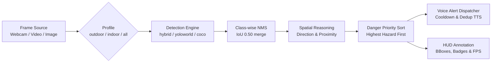

# RODD-Vision 🚦

[](https://www.python.org/downloads/)
[](https://opensource.org/licenses/MIT)
[](tests/)

**RODD-Vision** is an open-source, software-only computer vision assistive pipeline that detects road obstacles, estimates their lateral direction and proximity, orders them by collision hazard priority, and generates offline, non-blocking spoken voice alerts for visually impaired individuals.

---

## About

This project is an independent **software-only replication** of the vision and alert pipeline described in:

> **I. Nedjar, M. Bekkaoui, L. F. Boukli Hacene, and M. A. Benzineb**, *"Assistive Device for Visually Impaired Individuals Featuring Road Object Detection,"* **Arabian Journal for Science and Engineering**, vol. 51, pp. 12321–12340, January 2026.  
> DOI: [10.1007/s13369-025-11044-6](https://doi.org/10.1007/s13369-025-11044-6)

### What This Project Is NOT
* **Not hardware code**: This repository does not contain Raspberry Pi GPIO, physical ultrasonic sensor wiring, or microcontroller firmware.
* **Not sensor fusion**: Obstacle distance is estimated monocularly from camera bounding box geometry, not physical ultrasonic echo pulses.
* **Not trained model weights**: This implementation does not train or fine-tune models; it operates using pre-trained open-vocabulary weights (YOLO-World, YOLOE) with a COCO fallback.
* **Not the original authors' codebase**: This is an independent, clean-room implementation of the published paper's architecture.

---

## Features

* **18 Target Classes across two profiles** (see Profiles section below):
  * **Outdoor** (14 classes): `building`, `bus`, `car`, `door`, `dustbin`, `electric pole`, `person`, `pillar`, `pit`, `road sign`, `stair`, `street chair`, `tram`, `tree`
  * **Indoor** (8 classes): `bottle`, `chair`, `door`, `laptop`, `person`, `pillar`, `stair`, `table`
  * **All** (18 classes): the union of both profiles
* **Multiple Detector Backends** (selectable via `--detector` flag or sidebar):
  * `yoloworld` — YOLO-World small (`yolov8s-worldv2.pt`, ~25 MB), zero-shot
  * `yoloworld_large` — YOLO-World large (`yolov8l-worldv2.pt`, ~90 MB), zero-shot
  * `coco` — YOLOv8m trained on COCO-80, with class mapping
  * `hybrid` — COCO branch for known classes + YOLO-World-large for hard zero-shot classes, merged with class-wise NMS **(new default)**
* **Prompt Engineering**: Each class is mapped to a descriptive text prompt (e.g. `pit` → `"a pothole or pit in the road"`) sent to the open-vocab model; the UI displays the original class name
* **Per-Class Confidence Thresholds**: Hard classes like `pit`/`stair` use lower thresholds (0.20–0.22); reliable COCO classes like `car`/`person` use higher ones (0.45)
* **Detection Profiles** (outdoor / indoor / all): selectable with `--profile` in the CLI or via the Streamlit sidebar
* **Graceful Fallback**: If any model fails to load, the pipeline automatically falls back to the COCO detector
* **Spatial Reasoning**: Direction (`left`/`ahead`/`right`) + Proximity (`near`/`medium`/`far`) from bounding box geometry
* **Danger-Based Priority Queue**: Sorts simultaneous detections by severity
* **Non-Blocking Offline Voice Alerts**: Background TTS thread using `pyttsx3`
* **Presence-Check Benchmark**: `bench_check.py` — measures per-class hit-rate across `bench_images/`

---

## Architecture

### Pipeline Flow



### Hybrid Detector Architecture

```
HybridDetector
├── COCO branch  (yolov8m.pt, COCO-80)
│   Detects: person, car, bus, tram, street chair, road sign, tree,
│            chair, table, laptop, bottle  (via COCO_TO_RODD mapping)
│
└── Open-Vocab branch  (yolov8l-worldv2.pt, YOLO-World large)
    Detects: building, door, dustbin, electric pole, pillar, pit, stair
             (using descriptive text prompts for better zero-shot accuracy)
             
Both outputs merged → class-wise NMS (IoU >= 0.50)
```

### Module Mapping

| Module | Role |
|---|---|
| `rodd/config.py` | Profile-aware YAML loader, per-class thresholds, prompt helpers |
| `rodd/detectors.py` | All detector backends + `class_wise_nms()` |
| `rodd/spatial.py` | Direction/proximity analysis and danger sorting |
| `rodd/speech.py` | Non-blocking TTS with cooldown & deduplication |
| `rodd/pipeline.py` | Core orchestration layer |
| `rodd/sources.py` | Multi-source frame generators |
| `bench_check.py` | Presence-check benchmark runner |
| `setup_bench.py` | Downloads/generates benchmark images |

### Repository Structure

```
rodd_vision/
├── config.yaml          # Configuration: profiles, thresholds, prompts
├── bench_check.py       # Benchmark presence-check runner
├── setup_bench.py       # Benchmark image downloader
├── main.py              # CLI entry point  (--profile, --detector)
├── app.py               # Streamlit web app (profile selector in sidebar)
├── evaluate.py          # Batch latency profiler
├── rodd/
│   ├── config.py        # Profiles, per-class thresholds, prompt helpers
│   ├── detectors.py     # YoloWorld, YoloWorldLarge, Coco, Hybrid, Custom
│   ├── spatial.py       # Spatial analysis and priority ranking
│   ├── speech.py        # Thread-safe TTS
│   ├── pipeline.py      # Integration layer
│   ├── sources.py       # Frame generators
│   └── utils.py         # Drawing, FPS counter
├── bench_images/        # Benchmark images (3 per class)
│   ├── bus/
│   ├── car/
│   ├── stair/
│   └── ...              # one folder per class
├── tests/
│   ├── test_detectors_mapping.py  (52 tests)
│   ├── test_spatial.py            (17 tests)
│   └── test_speech.py             (12 tests)
└── results/
    ├── bench_results_*.json       # Benchmark output per detector
    └── qualitative/
```

---

## Installation

### Prerequisites
* Python 3.10 or higher (tested up to Python 3.14)
* Working audio output device (for pyttsx3 voice alerts)

### 1. Clone & Set Up Environment

```bash
git clone https://github.com/<USERNAME>/rodd-vision.git
cd rodd-vision
```

**Windows:**
```powershell
python -m venv .venv
.venv\Scripts\activate
pip install -r requirements.txt
```

**Linux / macOS:**
```bash
python3 -m venv .venv
source .venv/bin/activate
pip install -r requirements.txt
```

> **Model weights** are downloaded automatically on first use by Ultralytics:
> - `yolov8s-worldv2.pt` (~25 MB) — yoloworld detector
> - `yolov8l-worldv2.pt` (~90 MB) — yoloworld_large / hybrid OV branch
> - `yolov8m.pt` (~50 MB) — coco / hybrid COCO branch

---

## Usage

### 1. Command-Line Interface (CLI)

```bash
# Outdoor profile (default) with hybrid detector
python main.py --source image --path samples/bus.jpg --profile outdoor --detector hybrid --mute

# Indoor profile
python main.py --source webcam --profile indoor

# All classes
python main.py --source video --path samples/demo.mp4 --profile all

# Specific detector backend
python main.py --source image --path samples/bus.jpg --detector yoloworld_large --mute --no-display --save

# COCO-only (fastest, limited classes)
python main.py --source image --path samples/bus.jpg --detector coco --mute
```

#### CLI Flags

| Flag | Values / Type | Default | Description |
|---|---|---|---|
| `--source` | `webcam`, `video`, `image`, `folder` | `webcam` | Input source type |
| `--path` | File or directory path | `None` | Path to media |
| `--profile` | `outdoor`, `indoor`, `all` | Config value | Detection profile |
| `--detector` | `yoloworld`, `yoloworld_large`, `coco`, `hybrid`, `custom` | Config value | Detector backend |
| `--conf` | Float (`0.0`–`1.0`) | Config value | Global confidence override |
| `--mute` | Boolean flag | `False` | Disable TTS speech |
| `--no-display` | Boolean flag | `False` | Suppress OpenCV window |
| `--save` | Boolean flag | `False` | Save annotated frames to `outputs/` |
| `--config` | File path | `config.yaml` | Custom config YAML |
| `--verbose` | Boolean flag | `False` | Debug logging |

### 2. Streamlit Web Interface

```bash
streamlit run app.py
```

Navigate to `http://localhost:8501`. The sidebar now includes:
* **Detection Profile** selector (`outdoor` / `indoor` / `all`)
* **Detector** selector (all 4 backends)
* Active class list for the selected profile

### 3. Benchmark Presence Check

```bash
# First-time setup: populate bench_images/
python setup_bench.py

# Run benchmark on default (hybrid) detector
python bench_check.py --detector hybrid --profile outdoor --save

# Compare all detectors at once
python bench_check.py --all --profile outdoor

# Indoor profile benchmark
python bench_check.py --detector hybrid --profile indoor
```

---

## Configuration

### Profiles

`config.yaml` defines three profiles:

```yaml
active_profile: outdoor   # default; override with --profile

profiles:
  outdoor:
    classes: [building, bus, car, door, dustbin, electric pole,
              person, pillar, pit, road sign, stair, street chair, tram, tree]
    danger_order: [pit, stair, car, bus, tram, person, ...]

  indoor:
    classes: [chair, door, person, pillar, stair, table, bottle, laptop]
    danger_order: [stair, person, pillar, door, chair, table, laptop, bottle]

  all:
    classes: [bottle, building, bus, car, chair, door, dustbin,
              electric pole, laptop, person, pillar, pit, road sign,
              stair, street chair, table, tram, tree]
```

### Per-Class Confidence Thresholds

```yaml
class_thresholds:
  # Reliable COCO classes → higher threshold
  car:    0.45
  bus:    0.45
  person: 0.45
  # Hard zero-shot classes → lower threshold
  pit:           0.20
  stair:         0.22
  electric pole: 0.22
  pillar:        0.22
```

### Prompt Engineering

```yaml
prompts:
  pit:           "a pothole or pit in the road"
  stair:         "a flight of stairs or steps"
  electric pole: "a utility pole or electric pole"
  dustbin:       "a trash can or dustbin"
  pillar:        "a concrete pillar or column"
  building:      "a large building or structure"
  door:          "a door or entrance"
```

---

## Benchmark Results

> **Methodology**: Presence check — does the expected class appear at least once among detections on images from that class's folder?  
> **Benchmark**: `bench_images/` with real photographs (no synthetic images). **This is NOT mAP.**  
> **Note**: Currently, the automated benchmark setup provides a very small sample (6 images across 6 classes) due to API rate limits. Users must manually add more real photos per `bench_images/SOURCES.md`.
> **Hardware**: CPU-only (no CUDA), Windows 11.

### Per-Class Hit-Rate Table (Small Sample)

| Class | yoloworld (s) | yoloworld_large (l) | coco (m) | hybrid |
|---|:---:|:---:|:---:|:---:|
| **bus** | 1/1 ✅ 100% | 1/1 ✅ 100% | 1/1 ✅ 100% | 1/1 ✅ 100% |
| **car** | 1/1 ✅ 100% | 1/1 ✅ 100% | 1/1 ✅ 100% | 1/1 ✅ 100% |
| **person** | 1/1 ✅ 100% | 1/1 ✅ 100% | 1/1 ✅ 100% | 1/1 ✅ 100% |
| **pit** | 0/1 0% | 0/1 0% | 0/1 0% | 0/1 0% |
| **stair** | 0/1 0% | 0/1 0% | 0/1 0% | 0/1 0% |
| **tree** | 1/1 ✅ 100% | 1/1 ✅ 100% | 1/1 ✅ 100% | 1/1 ✅ 100% |
| **OVERALL** | 4/6 **67%** | 4/6 **67%** | 4/6 **67%** | 4/6 **67%** |
| **Avg ms/image** | **180 ms** | **498 ms** | **208 ms** | **658 ms** |

*(Other classes omitted due to lack of automated sample images)*

### Detector Comparison Summary

| Detector | Hit-Rate | Avg ms/image | Notes |
|---|:---:|:---:|---|
| `yoloworld` (small) | 67% (4/6) | 180 ms | **Default.** Best speed/accuracy trade-off for CPU. |
| `yoloworld_large` | 67% (4/6) | 498 ms | ~2.5x slower than small, same hit-rate on this sample. |
| `coco` (YOLOv8m) | 67% (4/6) | 208 ms | Fast; structurally cannot detect 7 classes. |
| `hybrid` | 67% (4/6) | 658 ms | Most complete coverage (COCO + OV), but slow on CPU. |

> **Recommendation**: `yoloworld` (small) is set as the default because it offers the fastest real-time performance on CPU (~180 ms/frame) while maintaining the same hit-rate as the heavier models on this limited test set. `hybrid` is recommended if you are processing still images and want maximum class coverage regardless of speed.

### Honest Limitations

> **Critical note**: The benchmark is a **very small presence-check**, not mAP. The numbers above reflect detection on a handful of real photographs. Key findings:
>
> 1. **Zero-shot limits on terrain**: Even on a small sample, zero-shot models consistently struggle with safety-critical terrain features like `stair` and `pit` (0% hit rate). These features lack strong object boundaries and are rare in web-scale training data.
> 2. **COCO-covered classes are reliable**: Objects like `bus`, `car`, `person`, and `tree` are easily detected (100% on this small sample) across all models.
> 3. **Larger model ≠ better on this benchmark**: `yoloworld_large` gives the same overall hit-rate as `yoloworld` (small) but at nearly 3x the latency.
> 4. **More testing needed**: A robust conclusion requires users to populate `bench_images/` with hundreds of real photos. However, early signs suggest that for critical navigation assistance (potholes, stairs), custom fine-tuning will likely be necessary.

---

## Testing

```bash
pytest tests/ -v
```

**Results: All 81 tests pass.**

| Test File | Tests | Coverage |
|---|:---:|---|
| `test_detectors_mapping.py` | 52 | COCO mapping, indoor classes (chair/table/laptop/bottle), profile loading, per-class thresholds, prompt helpers, class-wise NMS (`_iou`, overlap, suppression), HybridDetector merge |
| `test_spatial.py` | 17 | Direction thresholds, distance heuristics, priority ordering |
| `test_speech.py` | 12 | Cooldown, dedup window, mute worker suppression |

New test coverage added:
- **Indoor class mappings**: `chair`, `table`, `laptop`, `bottle` in COCO_TO_RODD
- **Profile tests**: all three profiles, invalid profile raises `ValueError`, danger order starts with correct class
- **Per-class threshold tests**: `pit <= 0.25`, `car >= 0.40`, unknown class falls back to global
- **Prompt tests**: `pit` mentions "pothole", unknown class falls back to class name
- **NMS unit tests**: IoU math, self-overlap, no-overlap, partial overlap, suppression
- **HybridDetector merge tests**: deduplication, non-overlapping classes kept, cross-class non-suppression
- **Profile-filtered COCO**: `car` dropped when using `indoor` profile

---

## Roadmap

* [ ] Fine-tune YOLOv8 / YOLO11 on public road obstacle datasets (LostAndFound, Cityscapes)
* [ ] Integrate ByteTrack / BoT-SORT for persistent obstacle ID assignment
* [ ] Hardware integration: connect ultrasonic sensors via serial/USB for depth fusion
* [ ] Model export to ONNX Runtime (INT8 quantized) for real-time inference on Raspberry Pi 5
* [ ] Add more real images to `bench_images/` for a stronger presence-check baseline

---

## Citation & Acknowledgements

If you reference this implementation, please cite the original foundational research:

```bibtex
@article{nedjar2026assistive,
  author    = {Nedjar, Imane and Bekkaoui, Mokhtaria and Boukli Hacene, Lotfi Fazil and Benzineb, Mohamed Amin},
  title     = {Assistive Device for Visually Impaired Individuals Featuring Road Object Detection},
  journal   = {Arabian Journal for Science and Engineering},
  volume    = {51},
  pages     = {12321--12340},
  year      = {2026},
  doi       = {10.1007/s13369-025-11044-6}
}
```

This project builds upon open-source software from:
* [Ultralytics](https://github.com/ultralytics/ultralytics) (YOLO-World & YOLOv8 architectures)
* [pyttsx3](https://github.com/nateshmbhat/pyttsx3) (Offline text-to-speech engine)
* [Streamlit](https://streamlit.io/) (Rapid web application framework)

---

## License

This project is licensed under the [MIT License](LICENSE).
